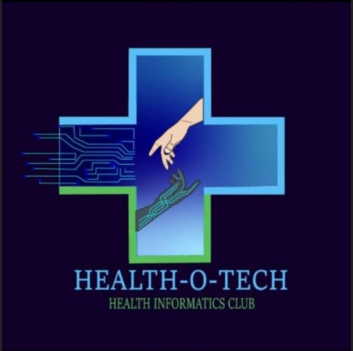

<div align="center">

  

  # Health-O-Tech (HOT)
  ### Where Healthcare Meets Deep Technology

  [](https://react.dev/)
  [](https://vitejs.dev/)
  [](https://tailwindcss.com/)
  [](https://www.framer.com/motion/)
  [](https://supabase.com/)
  [](LICENSE)

  <p align="center">
    <b>Health-O-Tech (HOT)</b> is VIT Bhopal's premier technical student chapter dedicated to pioneering advancements at the intersection of clinical medicine, computer science, and bio-engineering.
  </p>

  <p align="center">
    <a href="#-about-health-o-tech">About</a> •
    <a href="#-core-domains">Domains</a> •
    <a href="#-key-features">Key Features</a> •
    <a href="#-tech-stack">Tech Stack</a> •
    <a href="#-getting-started">Getting Started</a> •
    <a href="#-project-structure">Structure</a> •
    <a href="#-contributing">Contributing</a> •
    <a href="#-license">License</a>
  </p>

</div>

---

## 🧬 About Health-O-Tech

Modern healthcare is being transformed by machine learning, embedded biosensors, genomics, and clinical informatics. **Health-O-Tech** unites students, researchers, developers, and healthcare enthusiasts to build open-source innovations that solve real-world biomedical challenges.

From edge-AI diagnostic models to sub-$50 myoelectric prosthetic arms and secure patient telemetry networks, our club bridges the gap between theoretical computing and clinical impact.

---

## 🔬 Core Domains

| Domain | Focus Area | Technologies |
| :--- | :--- | :--- |
| **🧠 AI & Diagnostics** | Deep Learning, 3D MRI/CT scan segmentation, pathology classification & automated radiology assistance. | PyTorch, TensorFlow, MONAI, Vision Transformers |
| **🩺 IoT & Bio-Sensors** | Real-time biotelemetry patches, wearable ECG/PPG nodes, low-latency vital sign transmission. | ESP32-S3, AD8232, MQTT, BLE, FreeRTOS |
| **🧬 Genomics & Bio-Info** | Computational DNA sequence alignment, CRISPR off-target scoring, structural protein folding. | Biopython, BLAST, AlphaFold pipelines |
| **📊 Health Informatics & EHR** | Secure clinical databases, electronic health records, interoperable FHIR/HL7 schemas. | Supabase, PostgreSQL, FHIR/HL7, HIPAA Compliant Architecture |
| **🤖 Robotics & Bionics** | Surface EMG-controlled prosthetics, assistive exoskeletons, mechatronic surgery simulators. | Arduino, EMG Sensors, Servo Actuators, SolidWorks |
| **🥽 XR & Medical Simulation** | Interactive surgical training environments and anatomy visualization in augmented/virtual reality. | WebXR, Three.js, Unity, WebGL |

---

## ✨ Key Features of the Platform

- **⚡ Biopunk Cyber Dark Design**: Crafted with custom cyan (`#00C8FF`) and emerald (`#00E676`) bioluminescent accents, ambient glow effects, and modern glassmorphic surfaces.
- **🧬 Dynamic Particle Canvas**: High-performance bioluminescent particle field simulated natively in HTML5 Canvas reacting to cursor movements.
- **📊 Live Bio-Telemetry Bar**: Simulated telemetry vitals (ECG rhythm, SpO2, core temp, system status) anchored into the navigation layer.
- **🗂️ Interactive Innovation Showcase**: Categorized flagship projects with smooth spring re-layout animations powered by Framer Motion.
- **👥 Eraser-Style Org Hierarchy Chart (`/team`)**: Interactive tree view displaying the club executive directorate, department leads, and coordinators with filterable tabs and member bios.
- **🎟️ Digital Event Pass Generator**: Generates customized cyber event passes with dynamic QR codes for club hackathons and workshops.
- **📊 Google Drive Folder Live Sync**: Multi-tenure team rosters and leadership architectures synced dynamically via Google Apps Script Web App.

---

## 🛠️ Tech Stack

- **Framework**: [React 19](https://react.dev/) + [Vite 8](https://vitejs.dev/)
- **Routing**: [React Router DOM v7](https://reactrouter.com/)
- **Styling**: [Tailwind CSS v4](https://tailwindcss.com/) (`@tailwindcss/vite`) + Custom CSS design tokens
- **Animations**: [Framer Motion](https://www.framer.com/motion/)
- **Iconography**: [Lucide React](https://lucide.dev/)
- **Data Layer**: Google Drive & Sheets Live Sync API
- **Typography**: [Orbitron](https://fonts.google.com/specimen/Orbitron) & [Space Grotesk](https://fonts.google.com/specimen/Space+Grotesk)

---

## 🚀 Getting Started

Follow these instructions to set up the project locally on your machine.

### Prerequisites

- [Node.js](https://nodejs.org/) (version **18.x** or higher recommended)
- `npm` (bundled with Node) or `pnpm` / `yarn`

### 1. Clone the Repository

```bash
git clone https://github.com/vikalp1817243/Health-O-Tech-Webiste.git
cd Health-O-Tech-Webiste
```

### 2. Install Dependencies

```bash
npm install
```

### 3. Configure Environment Variables

Create a `.env` file in the root directory by copying the sample configuration:

```bash
cp .env.example .env
```

Open `.env` and fill in your Google Sheets Apps Script API URL:

```env
VITE_GOOGLE_SHEETS_API_URL=https://script.google.com/macros/s/YOUR_DEPLOYMENT_ID/exec
```

> **Note**: The application includes graceful fallback data if the API URL is not provided, allowing all UI flows and components to be tested locally.

### 4. Run Development Server

```bash
npm run dev
```

Visit `http://localhost:5173` in your browser.

### 5. Build for Production

```bash
npm run build
```

To preview the production build locally:

```bash
npm run preview
```

---

## 📁 Project Structure

```text
Health-O-Tech-Webiste/
├── .agents/                    # AI Agent skills & development conventions
│   └── skills/
│       └── health-o-tech-dev/  # Biopunk design & Framer Motion guidelines
├── public/                     # Static media assets, logos, and icons
│   ├── banner.jpg
│   ├── favicon.svg
│   └── logo.png
├── src/
│   ├── components/             # Reusable modular UI components
│   │   ├── home/               # Landing page sections (Hero, About, Domains, Projects, etc.)
│   │   ├── team/               # Org chart & team hierarchy components
│   │   ├── Footer.jsx          # Site footer with social links & branding
│   │   ├── Navbar.jsx          # Top navigation with status badge
│   │   └── ScrollToTop.jsx     # Route transition scroll handler
│   ├── context/                # React context providers (Theme, etc.)
│   ├── lib/                    # Team data loader & Google Sheets API sync
│   ├── pages/                  # Page routes (Home.jsx, Team.jsx)
│   ├── App.jsx                 # Route definitions & layout wrappers
│   ├── index.css               # Design tokens, fonts, and Tailwind styles
│   └── main.jsx                # Application root entry point
├── .env.example                # Sample environment configuration
├── gas/                        # Google Apps Script API templates
├── index.html                  # HTML entry point with biopunk typography
├── LICENSE                     # MIT License
├── package.json                # Project dependencies and build scripts
└── vite.config.js              # Vite configuration with Tailwind CSS v4
```

---

## 🤖 Agentic & AI Guidelines

This codebase is configured with an **Antigravity Agent Skill** at [`.agents/skills/health-o-tech-dev/SKILL.md`](.agents/skills/health-o-tech-dev/SKILL.md). When collaborating with AI agents:

- **Animation Rule**: Never mix CSS `transition-all` with Framer Motion transforms or layout animations to avoid frame stutters.
- **Design Tokens**: Always reference `--accent-cyan`, `--accent-green`, `--surface-card`, and `--border-accent` from `src/index.css`.
- **Forms**: Validate email inputs, display feedback alerts, and handle loading states using biometric-themed cyber styles.

---

## 🤝 Contributing

Contributions to Health-O-Tech projects and this website are warmly welcomed!

1. **Fork** the repository
2. **Create** a feature branch:
   ```bash
   git checkout -b feature/amazing-feature
   ```
3. **Commit** your changes:
   ```bash
   git commit -m "feat: add amazing feature"
   ```
4. **Push** to your branch:
   ```bash
   git push origin feature/amazing-feature
   ```
5. **Open** a Pull Request against `main`

---

## 📄 License

Distributed under the **MIT License**. See [`LICENSE`](LICENSE) for more information.

---

<div align="center">
  <sub>Built with ❤️ by <b>Health-O-Tech (HOT)</b> • Vellore Institute of Technology, Bhopal</sub>
</div>
